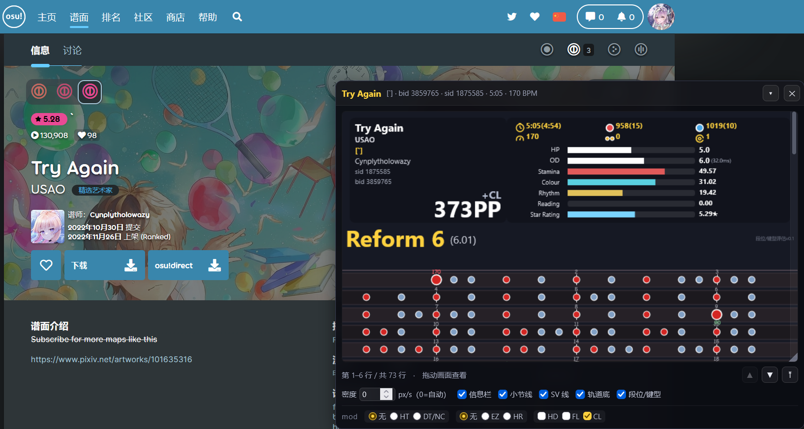
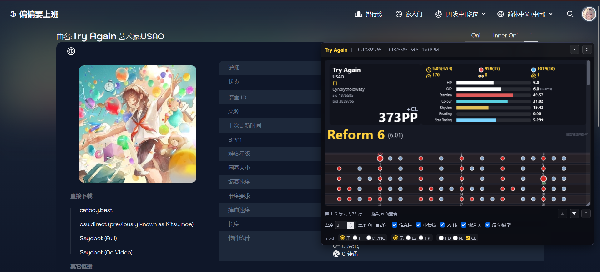

# osu!taiko 谱面预览器（浏览器扩展）

在 osu! 谱面页面右下角注入一个小窗口，显示该谱面的 **osu!taiko 静态预览图**。

核心渲染逻辑（解析 / 布局 / 绘制）直接复用 `../taiko-preview/`，两端行为一致。

> **这份是开发者向的文档。** 面向使用者的说明在
> [`README-user.md`](README-user.md)。
>
> GitHub 主页显示的是根目录的 `README.md`（由
> `tools/sync_readme.sh` 从 `README-user.md` 生成，内容与后者一致）。
> 改文案请改 **`README-user.md`**，那是唯一手写来源。

---

## 截图

**osu! 官网（osu.ppy.sh）**



**Bancho 系私服（osu.ppy.sb 等）**



两张是同一张谱（`Try Again` [1]），分别在官网与私服上——
可见信息栏、段位行（`Reform 6`）、四条 skill 占比、Star Rating 与最大 PP，
以及下面的 mod 区。截图存在 `docs/screenshots/`。

---

## 安装

### 给别人用（推荐：发 zip）

1. 生成 zip（**不要**直接压缩整个目录——里面有 6.8MB 开发文件，
   包括 100+ 张真实谱面样本，对方用不上）：
   ```bash
   bash tools/package_extension.sh
   ```
   产物在 `dist/taiko-preview-web-<版本>.zip`，**约 180KB / 18 个文件**。

2. 把这个 zip 发给对方（微信/网盘/github release 都行）。

3. 对方这样装：
   1. 解压到一个**不会被清理**的目录（比如 `工具/taiko-preview-web`）
      ——别放在下载目录，Chrome 可能会跟着清理
   2. 地址栏打开 `chrome://extensions`（Edge 是 `edge://extensions`）
   3. 右上角开启**「开发者模式」**
   4. 点**「加载已解压的扩展程序」**，选中刚才那个目录
   5. 打开 osu! 任意谱面页，窗口自动出现

4. 以后更新：把新 zip **解压覆盖**同一个目录，回到扩展页点刷新图标。

> ⚠️「加载已解压的扩展程序」装的是**目录**，不是 zip——
> zip 只是传输格式，对方需要解压。Chrome 不支持直接装 zip。

### 自己开发（用整个目录）

1. 打开 Chrome/Edge 扩展页 `chrome://extensions`
2. 开启「开发者模式」
3. 点「加载已解压的扩展程序」，选择本目录（`taiko-preview-web/`）
4. 访问任意 osu! 谱面页

改完代码后在扩展页点刷新图标即可，无需重装。

### 零依赖

没有 `package.json`、没有 `node_modules`、不需要 `npm install`。
全部逻辑是纯 JS（`lib/` 下 9 个 ES module），
Python 只在**开发时**用于生成标定数据与对拍，**运行时完全不需要**。

## 使用

| 操作 | 效果 |
|---|---|
| 拖动标题栏 | 移动窗口（位置自动记住） |
| **双击标题栏** | **恢复默认尺寸 700×520**（尺寸被写坏时的救急口） |
| 拖动窗口右下角`◢` | 调整窗口大小（宽度变了会按新宽度重算布局） |
| **在画面里按住拖动** | **上下平移预览图** |
| 鼠标滚轮 | 上下滚动 |
| 拖右侧细长缩略条 | 快速跳到任意位置（定位会扣掉滚动条自身的 top） |
| `▲` `▼` | 上下滚半屏（也可用键盘 `↑` `↓` / `PageUp` `PageDown`） |
| `⤒` | 回到开头（也可用 `Home` / `End`） |
| `▾` | 折叠成一条（再点展开，高度会还原） |
| `✕` | 隐藏窗口（重新进谱面页会自动回来） |
| 密度输入框 | 手动指定像素密度（0 = 自动按小节对齐） |
| 信息栏 / 小节线 / SV 线 / 轨道底 | 各自开关 |

窗口默认 700×520，可在 420×240 到全屏之间自由缩放，位置和尺寸都会记住。

## Star Rating / skill 占比 / 最大 PP

窗口底部的工具条有一排 **mod 选择**，默认开启 **CL**：

| 组 | 选项 | 说明 |
|---|---|---|
| 流速（互斥） | 无 / HT / **DT·NC** | 只能选一个，**「无」必须有**（否则勾上就取消不掉） |
| 难度（互斥） | 无 / EZ / HR | 同上 |
| 其他（独立） | HD / FL / **CL** | 可多选 |

**DT 与 NC 合并成一个选项**：两者的计算完全一致（rate 都是 1.5，
`TAIKO_MODS` 里 DT/NC 两项除`hidden` 外完全相同），分开列只是冗余。

两组互斥项都用 `data-set="modRate"` / `data-set="modOd"` 标记自己属于哪组 ——
因为两组的「无」都是 `data-mod="None"`，靠 data-mod 分不出来。

勾选后立即重算，并显示在**左上角信息框的右下角**：

```
      CL          ← mod 缩写（无 mod 时显示 NoMod）
    766PP         ← 最大 PP（各 acc 预设里最高的那个）
```

`bid` / `sid` 在谱师下面**另起两行**，一行一个。

### Star Rating 的变化值

勾了会让星数变化的 mod（EZ/HR/HT/DT）时，星数后面追加差值：

```
Star Rating  ▓▓▓▓▓▓▓░░░ 10.54★ (+2.71)
```

基准 = **只保留 CL/HD/FL** 的星数（`content.js` 的 `baseStarRating()`）。
必须排除 EZ/HR/HT/DT —— 它们改的是难度参数，那种变化不是「相对这张谱」
而是「相对另一个难度」。基准按谱面 ID 缓存，连续切 mod 不会重复计算。

### 时长与 BPM 按 mod 折算

| mod | 时长 | BPM |
|---|---|---|
| DT / NC（rate 1.5） | ÷1.5 | **×1.5** |
| HT（rate 0.75） | ÷0.75 | **×0.75** |

折算后的 BPM **四舍五入到整数**（`230 × 0.75 = 173`，不会出现 `172.5`）。
标题栏与画布信息栏都用同一个 `renderer._modRate()`，不会自相矛盾。

### OD 用官方口径 `displayOdLazer`，不是`displayOd` / `od`

`sr_panel.display` 里有**三个** OD，差别很大：

| 字段 | 含义 | HT 会变吗 |
|---|---|---|
| `od` | base 的结果，**已被封顶到 10** | 否 |
| `displayOd` | osu!stable 的「apparent OD」延拓，只在判定窗<20ms 时启用 >10 | **否** |
| `displayOdLazer` | **官方口径**：`InverseDifficultyRange` 从判定窗反解 | **是** |

官方源码 `reference-csharp/More/osu.Game.Rulesets.Taiko_TaikoRuleset.cs:310`
用的是第三个。官方单测 `TaikoRateAdjustedDisplayDifficultyTest` 断言：

```
OD5 + HT → 1.11    (HT 让判定窗变宽 -> OD 显示值下降)
OD5 + DT → 8.89
```

`displayOd`（stable 口径）算不出 HT 方向 —— 它的公式只在 `great < 20ms`
时启用，`rate 0.75` 把判定窗变宽，公式直接返回封顶值。这正是用户反馈
「HT(HR+HT / EZ+HT) 没有对 OD 产生影响」的根因。信息栏画 `displayOdLazer`。

**OD 后面用小字附上实际判定窗** `(29.0ms)`：官方公式是线性外推，
判定窗足够宽时会算出**负数**（`EZ+HT → -0.89`）。既然是官方口径就原样显示，
用判定窗把它解释清楚，比悄悄钳到 0 更有信息量。

**OD 小数位按「OD 是否真的变了」自适应**：

| 情况 | 显示 |
|---|---|
| 无 mod / CL / HD / FL（都不改难度参数） | `7.0` 一位小数 |
| EZ / HR / HT / DT（改了 OD 或判定窗） | `10.22` 两位小数 |

判据是 `|odShown - bm.od| >= 0.005`，**不是**「有没有勾 mod」——
CL/HD/FL 虽然勾了但 `TAIKO_MODS` 里 od/sm/rate 全是 1.0，OD 原样，
多给一位小数只是噪音。HP 始终一位小数，且**不带判定窗后缀**（判定窗只对应 OD）。

实测（原 OD=7）：

| mod | OD | 判定窗 |
|---|---|---|
| None | 7.00 | 29.0ms |
| DT | 10.22 | 19.3ms |
| HT | 3.78 | 38.7ms |
| HR+HT | 7.51 | 30.7ms |
| EZ+HT | -0.89 | 66.7ms |

### 信息栏右侧的刻度条

去掉了「全曲密度」「最密 30%」两条，换成**四项 skill 占比 + Star Rating**，
HP / OD 两条保留（显示的是 **mod 调整后**的值）：

```
HP           ▓▓▓▓▓░░░░░░3.50
OD           ▓▓▓▓▓▓▓▓░░7.00
Stamina      ▓▓▓▓▓▓▓▓░░░░52.47
Rhythm       ▓▓▓▓▓░░░░░░23.94
Colour       ▓▓▓▓▓░░░░░░22.12
Reading      ▓░░░░░░░░░░ 1.47
Star Rating  ▓▓▓▓▓▓░░░░ 7.83★
```

- 刻度**逐项不同**：体力 **0~65%**、其余三项 **0~45%**、Star Rating **0~10**
  （体力常年占 40~60%，若也用 45% 上限会长期顶格、看不出差别）
- **溢出与 HP/OD 同语义**：正常段用本色，超限段用红色`#ff3b30` **从左端覆盖**，
  超过 2× 刻度按 2× 封顶。Star Rating 超过 10 很常见（DT 下的高星谱），
  没有溢出处理时 3.50和 30.00 会长得一模一样，完全看不出超了多少。

  | Star Rating | 正常段 | 超限段 |
  |---|---|---|
  | 3.50 | 35% 本色 | — |
  | 10.00 | 满格本色 | — |
  | 12.34 | 满格本色 | 23% 红色 |
  | 20.00+ | 满格本色 | 满格红色（封顶） |

  四条 skill 占比恒在 0~1、实际不会溢出，这条路径是专门为 SR 准备的。
- 标签**只有英文**，数值省略百分号、保留两位小数
- **顺序固定** Stamina / Colour / Rhythm / Reading —— 之前按占比排序，
  换个 mod 某项占比变了就跳位，四条 bar 会左右乱窜，很难对比
- 七条的标签右缘 / 条形长度 / 数值左缘**严格对齐**——
  `_drawMeterBar`（HP/OD）与 `_drawRatioBar`（skill/SR）共用
  `_barGeom()` 与 `LABEL_PAD`，不再各算一套
- 条形数量多，右栏宽度从可用宽度的 56% 提到 **68%**，内容整体右移贴住右缘

### 算法来源与精度

SR / PP 来自 `lib/difficulty.js`、`lib/pp.js`、`lib/sr_panel.js`
（由 `taiko-sr-analysis/` 的 Python 实现移植而来）。该 Python 实现已与
**官方 `osu.Game.Rulesets.Taiko` 2026.730.0** 逐位一致，
`test/sr_verify.mjs` 用官方 C# 的原始输出反向校验 JS 版：
**12 个难度全部逐位吻合，Star Rating 最大偏差 1.9e-8**。

### 组合 mod 是**算出来**的，不是查表

`TAIKO_MODS` 只列了官方预置的几个组合（`HD+DT` / `CL+EZ+HD` …），
但界面允许自由勾选，`HT+CL`、`EZ+FL`、`DT+CL+HD` 这些表里根本没有。
所以 `difficulty.resolveMod(name)` 会把各 mod 的效果**组合**起来：

```
od  = 连乘（EZ 0.5 / HR 1.4）      sm  = 连乘
rate= 取流速类 mod 的值（界面保证 HT/DT/NC 互斥）
hidden / flashlight / classic / easy = 逻辑或
```

单个 mod 与预置组合都走这条路径，行为与查表完全一致（已被逐位校验覆盖）。

## 顶部信息栏

画在预览图顶部（也就是整首的最上方），版式与网页版一致，但**按窗口宽度等比缩放**：

- **左上**：曲名 / 歌曲作者 / `[难度名]`（黄色）/ 谱师，其下 `sid` `bid` 各一行，
  **右下角是最大 PP + mod 缩写**
- **右上**：两行三列统计（时长、红饼(大饼)、蓝饼(大饼)、BPM、连打、转盘）
  + 七条刻度条（HP、OD、四项 skill 占比、Star Rating）

缩放系数 `k = clamp(宽度 / 1500, 0.46, 1)`：宽画布 `k=1` 与网页版完全一致，
420px 的小窗 `k≈0.46`。字号有下限（不会缩成看不清的蚂蚁字）。
可以在工具条用「信息栏」开关关掉。

### 右栏的三处版式约束

1. **标签列宽度由最宽标签反推**，不用拍脑袋的 `F(96, ...)`。
   标签是 sr_panel 的 `name`（"体力 Stamina" 这类中英对照）+ `Star Rating`。
   全角字宽 ≈ 1.0em、半角 ≈ 0.6em（实测比 0.5 宽），
   所以 `need ≈ max(6.8em, 6.6em) ≈ 6.8em`。
   列宽不足时 `_ellipsis` 会把「体力 Stamina」截成「体力 Stami…」。
2. **第二行统计的图标底不得压到第一条刻度条**。图标画在
   `基线 − 0.55×边长`，所以底是 `基线 + 0.45×边长` ——
   `BARS_Y0` 必须从这个值再往下留，不能只按「基线 + 6px」算。
3. **条形数变了，框高要跟着重算**。从 4 条变成 7 条后，
   `rightNeed = BARS_Y0 + BAR_STEP × 6 + BAR_H + PAD_IN`，
   否则最后一条（Star Rating）会被裁掉。
4. **`fullW` 只能是「整块可用宽度」，不能预先扣掉 `LABEL_COL`/`VAL_W`**。
   `_barGeom(x, fullW, labW, valW)` 内部会自己扣 —— 双重扣减会把条形
   压到 `Math.max(20,…)` 的下限。`VAL_W` 从 52 涨到 128 之后，
   多扣的 76px 全打在条形上，用户立刻就看到「条形图怎么变这么短了」。
   实测修复后条形占可用宽度 47%（640px）~ 63%（1920px）。

| 画布宽 | k | 信息栏高 | 左栏 | 右栏 | 标签列 |
|---|---|---|---|---|---|
| 420 | 0.46 | 180px | 130 | 268 | 70 |
| 660 | 0.46 | 180px | 223 | 396 | 70 |
| 1000 | 0.67 | 244px | 297 | 566 | 83 |
| 1920 | 1.00 | 367px | 558 | 1118 | 118 |

### BPM 口径：主 BPM 按「覆盖时长」算

标题栏和信息栏的 BPM 必须同源，否则同一张谱会在两处显示不同数值。
**不能用「首拍 BPM」**（`bpmAt(t0)`）—— 变速谱常常开头 120 BPM 慢板引入、
主体 200+ BPM，两处必然对不上。

**主 BPM 也不能按「出现次数取众数」**：制谱者会在 gimmick 段落插入大量短红线，
这些标记次数多但每次只持续几十毫秒。实测 `t+pazolite - Otsukimi PARTY HARD`：
9487 BPM 出现 352 次、真实主 BPM 180 只出现 293 次 —— 按众数会显示 9487。

正确口径是**按覆盖时长加权**，并对可信度设闸：

```
hold[bpm] = 该 BPM 生效的总毫秒数
main      = hold 最大的那个
过滤      = bpm > 0 && bpm <= 1000     （beatLength<60ms 的超高 BPM 标记不是真 tempo）
min/max   = 只统计 hold >= 1000ms 的 BPM
```

效果：`Otsukimi PARTY HARD` 从 `45-9487(9487)` 修正为 `45-360(180)`。

### 背景图功能已移除

曾经尝试用官方图床 `assets.ppy.sh/beatmaps/{setId}/covers/cover.jpg`
当信息栏底纹，但在扩展里拿不到（CORS/CSP），所以**已整体删掉**
（渲染端的绘制逻辑 + `content.js` 的 `fetchBackground`/`bgCache`）。
信息栏恒定纯色底。

### 底部不留空

信息栏**不画**页脚（`osu!taiko 谱面预览` / 页码），高度也同步减掉那段 ——
用户反馈「信息栏和预览图中间有文字和一块空白」。`H = panelY + panelH + BOTTOM_PAD`，
`BOTTOM_PAD` 只有 `F(4,2)`。

### 高度只有一个来源

信息栏高度既被绘制代码用（决定每样东西画在哪），又被 `content.js` 用
（决定画布预留多少顶部空间）。**这两处必须调同一个函数**
`renderer.headerHeightFor(width)` —— 之前各算一套（绘制端按缩放算出需要
~190px，`content.js` 按 `260 × k` 只留 120px），结果最后一条刻度条被裁掉。
版式量集中在 `renderer.headerLayout(W)`，需要的测试也直接调它。

## 一行放多少物件（紧凑模式）

小窗只有几百 px 宽，网页版那套 34px 音符 / 60px 边距会导致**一行连一个完整
小节都放不满**。所以 `layout.applyCompact()` 按可用宽度等比缩小整套几何量，
并让每行放整数个小节：

```
每行 16分音符数 = measuresPerRow × meter × 4      （与 BPM 无关）
横向间距        = usable / 每行16分音符数
音符直径        = 间距 × 0.85   （夹在 8~34px）
行高/轨道高/子行步长/标签层高全部跟着音符直径走
```

| 窗口内容宽 | 边距 | 音符直径 | 轨道高 | 行高 | 每行小节 | 16分间距 |
|---|---|---|---|---|---|---|
| 420 | 26 | 8 | 15 | 26 | 3 | 7.7px |
| 660 | 26 | 11 | 16 | 26 | 3 | 12.7px |
| 800 | 26 | 13 | 19 | 27 | 3 | 15.6px |
| 1000 | 36 | 12 | 17 | 26 | 4 | 14.5px |
| 1300 | 36 | 16 | 23 | 34 | 4 | 19.2px |
| 1920 | 48 | 24 | 35 | 50 | 4 | 28.5px |

默认 660px 宽时一行放 **3 个完整小节 / 48 个16分音符**（改之前只有 16 个）。

**默认时间密度不做任何夹取**：`alignPixelsPerSecond` 算出多少就是多少，
这样每行恰好是整数个小节，小节线在各行对齐。此前夹到 `[180,480]` 会把
「3 个小节」压成「2.6 个小节」，小节线随即在行内漂移。

## 工作原理

1. **取谱面 ID**：官方站支持三种 URL 形态
   - `/b/1234`
   - `/beatmaps/1234`
   - `/beatmapsets/123?beatmap=456`（SPA 切难度时 hash 变化：`#osu/456`）
2. **下载裸 .osu**：`https://osu.ppy.sh/osu/{bid}`
   （失败时回退 `https://catboy.best/osu/{bid}`）
3. **解析 → 布局 → 渲染**：用 `lib/` 下三个模块
4. **紧凑布局**：`applyCompact()` 按窗口宽度缩放几何量 + 每行放整数个小节
5. **整首一次画成一张长 canvas**，放进固定高度的视口里，用
   `transform: translateY()` 平移查看。相比分页的好处：
   - 上下文连续，跨页的连打/转盘不会因为换 canvas 而断
   - 拖动时**不需要重新渲染**，天然跟手（分页方案每翻一次都要重画）

### ★ 窗口挂在 `<html>` 上，并且会自愈

```js
document.documentElement.appendChild(host);   // 不是 document.body
```

osu! 是 Nuxt，SPA 路由切换时会**重建 `body` 的子树**（换 layout 时替换挂载点）。
挂在 `body` 上的节点会被一起丢掉，而 `buildUI()` 只在启动时挂一次 ——
于是就出现「内部状态一切正常（`visible: true`），但页面上什么都没有」，
唯一能救的就是刷新。

`<html>` 是 `body` 的**父节点**，Nuxt 只管 `body` 内部，挂上去就躲开了清理范围。

即便如此仍保留自愈机制（Nuxt 也可能在某些流程里清整个文档）：

- `show()` 的**第一步**是 `ensureHostMounted()` —— 顺序不能反，
  `display=''` 设在脱离文档的元素上毫无效果
- `syncVisibility()` 判 `!state.visible || !ui.host.isConnected`
- 轮询每 250ms 检查一次，掉了就重新挂载 + 重画
  （Nuxt 可能先清空 body 再异步填新内容，**不伴随 URL 变化**，
  这时路由监听的三层入口一个都不会触发）
- `status` 回执带 `mounted`，popup 据此显示「重新挂载窗口」

### 路由监听：三层，缺一不可

| 层 | 机制 | 覆盖 |
|---|---|---|
| 1 | `page_route_hook.js` 注入**页面世界**，劫持 `pushState`/`replaceState` | SPA 切页（Nuxt / vue-router 走的就是这个）|
| 2 | `popstate` / `hashchange` 事件（钩子内部） | 浏览器前进后退、手动改 hash |
| 3 | `setInterval(250ms)` 轮询 + `visibilitychange` 补判 | 兜底、后台节流、宿主自愈 |

**第 1 层为什么必须在页面世界**：content script 跑在隔离世界（isolated world），
有独立的 `window`/`history` 对象，与页面共享 DOM 但**不共享 JS**。
在 content.js 里写 `history.pushState = ...` 改的是 content script 自己那份，
页面的 vue-router 调的还是页面那份 —— **补丁完全无效**。
正确做法是用 `<script>` 注入页面世界，再用 `CustomEvent` 把通知送回来。

**第 3 层的 `visibilitychange`**：Chrome 把后台标签页的定时器节流到
「每分钟一次」，而 `visibilitychange` 是**事件**、不受节流影响 ——
用户切回标签页那一刻立刻补判一次就恢复了。


### 窗口显隐跟随路由

`manifest.json` 的 `matches` 放宽到整个站点（`https://osu.ppy.sh/*`）。
官网是 SPA —— 从谱面页退到商店**不会重新加载文档**，脚本一直在跑，
只是没有 bid可用。所以显隐由 `onMapPage()`（= 有没有 bid）统一决定：

- 退到商店/首页 → 自动隐藏
- 重新点进谱面 → 自动恢复（解决「窗口消失后只能刷新」）

**任何隐藏都只作用于当前这一页** —— 点 `✕`、点 popup「隐藏」都一样，
切谱或进出谱面页都会重新弹出。

### 为什么没有「永久关闭」

v1.2.x 曾用持久化的 `userClosed` 表达「用户主动关掉」，本意是
「关掉之后就别再烦我」。但它和用户真正要的直接冲突 ——
用户两次反馈的都是同一句话：

> 「退到商店页面再重新进入谱面页，窗口应该自动弹出来」

而 `userClosed` 一旦存进 `chrome.storage`，这条路径就被**永久堵死**：
路由监听每次都命中 `if (state.userClosed) hideByRoute()`，
连 popup 的按钮都救不回来（要先意识到「再点一次」才行）。

所以现在的语义是**隐藏只压当前页**。`userClosed` 退化成**瞬时标记**
（只给 popup 显示用），既不写入 storage，也不参与显隐决策。

长canvas 的高度对浏览器上限：Chrome 单边约 32767px、面积约 2.68 亿 px。
实测 14 张真实 taiko 谱在 660px 宽下最高 11750px（约 40 屏），
离上限有两个数量级的余量，所以不存在"画布过大"的问题。

## 模式支持：taiko 与 std（转谱），不显示 mania / catch

osu! 的 `[General] Mode` 决定玩法：**1 = taiko，0 = osu!(std)**，
2 = catch，3 = mania（4+ 是历史遗留的 mania 变体）。

| Mode | hash | 行为 |
| --- | --- | --- |
| 1 taiko | `#taiko/1234` | 原生显示 |
| 0 std | `#osu/1234` | **按官方 TaikoBeatmapConverter 转谱后显示** |
| 2 catch | `#fruits/1234` | 不显示窗口 |
| 3+ mania | `#mania/1234` | 不显示窗口 |

用户需求原文：「如果网页链接里不是 taiko，例如
`https://osu.ppy.sh/beatmapsets/2599592#mania/5810803`，则不要显示窗口。」
所以 mania / catch 一律**整窗隐藏**（不是弹一个报错窗）；
而 std 是可以做转换适配的，所以**放行**并显示转谱视角，
信息栏在 **bid 后面追加一个黄色的 `(转谱)`**——
否则窗口里的星数会被误当成那个 osu! 难度自己的星数。

> ★ 标记必须画在 **bid 那一行的后面**，不能另起一行。
> 早先版本在「难度名」与「谱师」两行之间画了「转谱预览 osu!→taiko」，
> 偏移 0.62 行、字号 3/4 —— 看着像卡在行间空隙里，实际窄窗口下
> `k` 缩放让行高变紧时仍会与谱师那行**叠字**（用户截图实测）。
> 同行追加不可能叠（基线完全相同），只需保证不超左栏宽度；
> 放不下就整个省略标记 —— 宁可少信息也不要糊成一团。

### 两层判据

1. **hash 写了模式**（`#osu/ #taiko/ #mania/ #fruits/`）：直接判定，
   连 `https://osu.ppy.sh/osu/{bid}` 都不下载。
2. **hash 没写模式**（`/b/1234`、`/beatmaps/1234`、`?beatmap=456`）：
   URL 里没有任何模式信息，只能等 `.osu` 的 `Mode:` 行落地才能确认
   （`peekOsuMode()`），确认是 2/3+ 就整窗隐藏。

判据统一放在 `onMapPage()`，显隐、popup 按钮、状态回执共用同一份结论，
不会出现「窗口没显示但 popup 说已加载」的矛盾状态。
`state.modeBlocked` 记住被拦的 bid，同一张谱来回切页面不会重复下载；
切到别的难度（bid 变了）记录自动作废。

### std 转谱做了什么

`lib/osu_parser.js` 的 `convertObjectToTaikoNotes()` 复刻
`osu.Game.Rulesets.Taiko.Beatmaps.TaikoBeatmapConverter`：

- circle → Hit：含 clap / whistle → Kat(蓝)，否则 Don(红)。
  **std 不会产生大饼**（大饼是 taiko 原生概念）。
- slider → 短滑条按 `shouldConvertSliderToHits` 拆成一串 Hit，
  间隔 `min(beatLength / SliderTickRate, taikoDuration / spans)`；
  其余 → DrumRoll，`Finish` 命中音 → 强连打。
  拆点取色用**逐节点音效**（.osu 第 9 字段 `edgeSounds`，
  节点数 = `slides + 1`，缺省继承滑条自身 hitSound）——
  与 C# 的 `IHasPathWithRepeats.NodeSamples` 一致。
- spinner / mania hold → Swell。

### std 的 ScrollSpeed（踩了最多的坑）

std 的 SV **不是** timing point 上的绿线。C# 的
`TaikoBeatmapConverter.ConvertBeatmap` 有一段 `OnlineID == 0` 后处理，
产出的 `EffectControlPoint` 序列由两轮合并而成：

1. **滑条 SV 变化点** —— 遍历物件，只有滑条携带
   `SliderVelocityMultiplier`（= `DifficultyPointAt(滑条时间)` 的值），
   与 `lastScrollSpeed` 不同才在**该滑条起始时间**插点。
2. **kiai 转折点** —— kiai 布尔翻转处插一个 `ScrollSpeed = 1.0` 的点
   （1.0 是 `EffectControlPoint` 的默认值：decoder 为 kiai 绿线产出的
   那个点没有赋 ScrollSpeed）。

两条硬约束，缺一条SR 就偏 0.005~0.029：

- `lastScrollSpeed` **只被第 1 轮更新**，第 2 轮不碰它。
  让 kiai 点顺手把状态置成 1.0，它后面的滑条会被全部误判成「SV 变了」。
- 第 2 轮**只在「kiai 转折时刻没有滑条」时**才插点。
  该处恰好有滑条时官方只给滑条那一个值。

`parseOsu` 额外产出 `bm.scrollPoints`，
`layout.svChanges` / `difficulty.svAtLocal` / `sr_panel.svForDifficulty`
在它存在时改用它 —— 否则读谱画面上的 SV 标记与实际滚动速度会对不上，
难度也会偏。

### 判定式细到 1e-8：float 语义必须逐处复刻

`shouldConvertSliderToHits` 的判定是
`distance / osuVelocity * 1000 < 2 * beatLength`，两侧会算到几乎相等的值。
实测（Bass Slut [Dereban's Lewd Extra] t=80998 的滑条）：

| 写法 | cond | limit | 判定 |
| --- | --- | --- | --- |
| 漏 `(float)` 强转 | 685.7142922537669 | 685.714285714286 | false → DrumRoll |
| 保留 `(float)` 强转 | 685.7142857142858 | 685.714285714286 | true → 3 个 Hit |

差 6.5e-6 就足以让「3 个 Kat」变成「1 个 DrumRoll」，颜色难度与星数随之全错。
必须复刻的三处 float：

- `VELOCITY_MULTIPLIER` 是 `const float 1.4f`（float32 值1.399999976158142）
- `GetPrecisionAdjustedBeatLength` 里 `Math.Clamp((float)-x, 10, 10000)`
  的 **float 强转**
- `SliderMultiplier * VELOCITY_MULTIPLIER` 两个 float 相乘

★ 但**不要**给 `1000f / beatLength` 加 fround —— 那是字面量类型标注，
表达式里另两个操作数都是 double，除法本就在 double 下完成。
加了反而把 HITS 翻成 DrumRoll。

### 守门测试：直接对官方 C#

`test/std_convert_official.mjs` 用工作区里 9 张真实 std 谱
（983911 S3RL - Bass Slut，SV 结构特别刁钻：大量连续同速绿线 + 密集 kiai 段）
与**官方 `osu.Game.Rulesets.Taiko` 2026.7300`** 逐项对拍：
转换后的逐物件列表（type / startTime / duration）、物件数、StarRating。
实测 SR 最大偏差 **2.4e-8**，物件逐个吻合。

基准由 `StarRatingCheck` 的 `--objects` 模式导出
（转储官方 `GetPlayableBeatmap(taiko)` 的逐物件列表与 `EffectControlPoint` 序列）。

> **不要拿 Python 参考实现当转谱基准。**
> `taiko_diffcalc/` 是手工复刻 C# 的产物，历史上出过两次偏差：
> ① 拆滑条时用了滑条自身采样，而 C# 用逐节点 `NodeSamples`；
> ② 根本不解析 timing point 第 8 字段（kiai），算不出「kiai 转折点」，
>    因此 SV 序列必然与官方不同。
> 两次都是「复刻品之间的自洽」，不是与官方的一致。
> 原 `std_convert_parity.mjs`（对 Python）已标记废弃。

## 脏数据防御：一张谱把浏览器卡死

### 现象

1419088 Camellia feat. Nanahira - Bad Sweets, Bad Dreams（bid 2923535）
的 taiko 难度 `[Too Bad, dont play]`，一打开窗口就停在「正在读谱…」，
**连整个浏览器都卡住**（标签页都切不动）。

不是「谱面太大」——7777 个物件在正常谱里很常见（最大的 taiko 谱上万）。

### 根因

TimingPoints 里有 3 条导出器 bug 产生的脏数据：

```
-569220001,-6E-87,4,1,0,5,1,0        ← 时间 -6.4万小时、拍长 6e-87
-569220002, 272.177968100742,4,1,...
-569220000,-6E-87,4,1,0,5,1,0
```

`layout.measureTimes()` 的实现是逐小节累进：

```js
while (t < segEnd - 1e-6) { ...; t += beatLen * meter; }
```

拍长 `6e-87` 时单段要循环 **10^52 次** —— 不是「慢」，是**永远跑不完**，
主线程被彻底占死。实测 `parseOsu` 只需 42ms，`computeLayout` 直接超时。

### 修复分两层，各管一件事

**① `layout.measureTimes()` 的循环预算** —— 真正的死循环杀手

判据不是「拍长多小」，而是**这条红线在自己那一段里要循环多少次**：

```js
const BUDGET = Math.max(10000, reds.length * 8);
const stepMs = beatLen * meter;
const segSpan = segEnd - tp.time;
if (!(stepMs > 0) || segSpan / stepMs > BUDGET) {
  /* 只记红线起点那一拍，跳过整段 */
}
```

> ★★ 为什么不能按「拍长绝对值」判断：
> 短拍长的红线在真实谱面里非常常见，而且**无害**——
> Otsukimi PARTY HARD 有 101 条 `bl ∈ {0.25, 0.4, 0.063}`、
> INTERNET OVERDOSE 有 4 条 `bl=1E+15`，它们都只出现在**同一时刻**
> （距相邻红线 1~20ms），`while` 只跑 1~50 次就退出。
> 按绝对阈值丢掉会让 SR 从 7.22 掉到 6.90 / 4.90 掉到 4.70。
> 保留数据 + 限制循环，比「丢弃合法数据」正确得多。

**② `osu_parser` 的解析期校验** —— 只挡浮点下溢/溢出级别的脏值

```js
const MAX_TIME_MS   = 3_600_000;   // 时间戳绝对值上限（1 小时）
const MIN_RED_BEAT_MS = 1e-6;       // 红线拍长下限（1e9 BPM）
const MAX_RED_BEAT_MS = 1e6;        // 红线拍长上限
```

绿线（`beatLength < 0`）**不设上下限**——它的数值是 `-100/SV` 而非拍长。

### ★ 阈值调参踩的四个坑（全部是测试报出来的，不是读代码想出来的）

第一版阈值把红绿线合并成一个区间，`sr_verify` 与 `difficulty_parity` 直接挂了
（3171/3360、SR 4.899 vs 4.697）。逐条查下来：

| 坑 | 症状 | 真相 |
|---|---|---|
| 拍长上限设 60ms（1000 BPM） | 误丢 757 条 | `bl=272.178` 是 **22 BPM 慢速段**，osu! 里完全合法（breaks 前后常有 20~30 BPM 拖段），163 条 |
| 上限对绿线也生效 | SR 4.90→4.70 | `bl=-1472.39` 只是 **SV ≈ 0.068**，绿线数值是 `-100/SV`，不是拍长，431 条 |
| 时间按 `t >= 0` 判定 | SR 偏 0.02~0.3 | **负时间合法**：`-996,428.57` 是音频淡入（AudioLeadIn）用的红线，osu! 允许 timing point 落在 0ms 之前 |
| 下限对绿线也生效 | SR 7.22→6.90 | 绿线 `\|bl\|<1` 意味着 SV > 100，是「很快的滚动速度」，合法（实测有 `bl=-99999999999`，SV 高达 1e10），102 条 |

三条结论：

1. **「拍长偏大」从来不是脏数据特征** —— 慢速段、以及「导出器把 SV 误写成红线」都会产生大数值。
2. **红绿线必须用完全不同的判据** —— 红线数值是拍长（双向限幅），绿线是 `-100/SV`（不设限）。
3. **负时间不能按符号丢** —— 只能靠绝对值上限区分（-996 与 -569220001 差 5 个数量级）。

### 用户可见的提示

丢弃过条目时，信息栏 bid 下方会显示橙色的「已忽略 N 条异常数据」。
静默丢弃会让用户以为「谱面本来就这样」，而被丢的拍长会直接影响小节线位置。

### 守门测试（三条，缺一不可）

| 断言 | 位置 | 防什么 |
|---|---|---|
| `[8c-1]` 脏谱布局限时 + 结果合理 | `e2e.mjs` | 死循环复发 |
| `[8c-2]` 正常谱不得误丢（带已知脏数据白名单） | `e2e.mjs` | 阈值收太紧 |
| `[8c-3]` 直接打 `measureTimes` 的循环预算 | `e2e.mjs` | 预算被误删 |
| `[6]` 「已忽略」提示该出现时出现、不该出现时不出现 | `header_layout.mjs` | 提示逻辑写错 |

> ★ `[8c-3]` 为什么必须**单独**测：解析层已经把脏数据丢掉了，
> 所以 `[8c-1]` 那条端到端断言**测不到预算本身**——
> 实测把预算改成 `Infinity`，`[8c-1]` 依然是绿的（因为脏数据进不到布局）。
> 要验证预算，必须绕开解析层直接喂「一条 6e-87 的红线独占一整段」的最坏输入。

`[8c-2]` 的白名单目前只有一条：`INTERNET OVERDOSE` 的 `bl=1E+15` ×4
（t = 203235 / 206179 / 209124 / 212568）。判定它是占位值的依据是
同一时刻前后有正常红线覆盖：

```
203234, 368.098159509202,4,1,...   ← 真拍长
203235, 1E+15,4,1,0,60,1,8         ← 占位值（1E15ms ≈ 31700 年一小节）
203236, 368.098159509202,4,1,...   ← 真拍长
```

## 两个已修的显示 bug（都是「量到了 0」/「漏判该有背景的行」）

留档是因为它们的成因都不直观，容易改回去。

### 窗口突然变特别小（420×240）

`clampPanel()` 原本无条件夹取尺寸：

```js
var w = Math.max(MIN_W, Math.min(ui.panel.offsetWidth, window.innerWidth - GAP));
```

**窗口隐藏时 `offsetWidth` 是 0**（商店页/ 被 ✕ 关掉 / mania 拦截 / 被 SPA 摘出文档），
于是 `max(420, min(0, …))` = 420、`min(240, …)` = 240，
然后**把 420×240 写进 inline style**。之后 `show()` 只把 `display` 置回 `''`，
尺寸已经坏了；再拖一下还会被 `saveWindow()` 存进 storage，**跨会话生效**。

触发点很日常：窗口隐藏期间浏览器 resize 一次就会触发（`window.resize` 监听里调它）。

三道防线：

1. `clampPanel()` 量不到尺寸（`offsetWidth/Height <= 0`）时**直接返回**，不写任何 style。
2. `saveWindow()` 拒绝存宽度 < `MIN_W` 的值 —— 避免脏数据落盘。
3. `restoreWindow()` 不信任明显无效的存档（非有限数 / 低于 `MIN_W`/`MIN_H`），
   一律回落到 CSS 默认值。

另外 `restoreWindow` 里同步 `state.restoreH` 也加了 `offsetHeight > 0` 的前置：
`buildUI` 里 `restoreWindow` 早于首次 `show`，那时量到 0，
若照样存进 `restoreH`，「折叠 → 展开」会把高度还原成 0 再被夹到 `MIN_H` —— 同一类bug 的另一条路径。

**救急口**：标题栏双击 = 恢复默认 700×520 并落盘。

> 测试桩必须模拟「`display:none` 的祖先 ⇒ `offsetWidth/Height = 0`」，
> 否则这条回归测不出真东西。同理 shadow root 也要接上 `parentNode`，
> 否则 shadow tree 里的元素走不到 host。

### 休息段跨行时「轨道消失」与「条纹消失」——是两个独立的 bug

用户分两轮报了两个现象，根因完全不同。这节保留两者的对照，
因为它们都在同一段代码附近，且**只修一个时另一个仍然存在**。

#### (a) 轨道背景消失（第一轮）

轨道背景由 `renderer._computeRowContent()` 决定「哪些行算有内容」，
原先只看**音符**与**长物件（连打/转盘）**。而**休息段内部本来就没有音符**
——那正是休息的含义 —— 于是横跨多行的休息段里，
那些整段都落在休息里的行既没音符也没长物件，轨道被跳过，
只剩 `_drawBreakStripes()` 画出的斜条纹浮在空白背景上。

实测样本里有 **8 个休息段、共 17 行**命中。

修法：`_computeRowContent()` 也把**休息段覆盖的行**算作有内容。
行的取法必须与 `_drawBreakStripes()` 完全一致：

```js
const t0 = Math.max(bs, lay.t0), t1 = Math.min(be, lay.tEnd);
const r0 = lay.rowAt(t0);
const r1 = lay.rowAt(Math.max(t0, t1 - 1));   // 减1：结束正好在行首时不多算一行
```

#### (b) 条纹消失（第二轮，用户发现轨道有了但条纹还是空的）

**行号与 `xInRow` 的反推行号错位。**

`layout.xInRow(t)` 内部自己`floor((t - t0) / rowDurMs)` 反推行号，
而 `_drawBreakStripes` 的行号是**循环变量 `r`**。
两者在「时间正好落在行边界」时差 1：

```js
const e = Math.min(t1, rowEndT);              // rowEndT = 下一行的行首
const x1 = lay.xInRow(e);                     // ← 用「下一行」算行内偏移 ≈ marginX
```

于是 `x1 ≈ marginX = 26`，而 `x0` 可能还是上一行末尾的 `674`
—— 宽度变成**负数**，被 `if (x1 - x0 < 0.5) continue` 整行跳过。

实测（Bass Slut [Dereban's Lewd Extra]，窗口 700px → 25 行、行长 4114ms）：

| 行 | x0 | x1 | 结果 |
|---|---|---|---|
| 14 | 503 | 674 | ✅ 26%（段起点，正常） |
| 15 | **674** | **26** | ❌ 反了，整行跳过 |
| 16 | **674** | **26** | ❌ 反了，整行跳过 |
| 17 | 26 | 165 | ✅ 21%（段终点，正常） |

表现为「两端有条纹、中间空着」，**很像「那段本来就没有休息段」**——
所以用户会问「还是说这里本身没有休息段？」答案是**确实有**，
只是中间那两行被算成了负宽度。

修法两条一起：

1. `layout.xInRow(t, rowArg)` 支持显式传行号（`rowArg === undefined` 时才自己反推）。
2. `_drawBreakStripes` 改成 `lay.xInRow(s, r)` / `lay.xInRow(e, r)`，
   **把循环变量传进去**，与 `lay.rowAt` 解耦。

其余 `xInRow` 调用点都是「先 `rowAt(t)` 再 `xInRow(t)`」配对使用，
不存在这个错位，所以只需改这一处。

#### 测试

- `e2e.mjs` `[8a]`：断言休息段覆盖的每一行都有轨道。
- `e2e.mjs` `[8b]`：断言每一行都真的画出了**正宽度**的条纹。
  判据读**真实绘制记录**（`ctx.fillRect` 的参数，颜色 `rgba(120,120,128,0.22)`），
  行 y 偏移取 `renderPage` 挂在 canvas 上的 `canvas.rowTops`。

> ★★ 这里踩过一个很典型的坑：**第一版断言自己重算了一遍算法**
> （直接调 `l2.xInRow(s, r)` 算 x0/x1），结果 renderer 改回错误实现时测试**仍然是绿的**
> —— 等于自己验自己。改成读真实 `fillRect` 记录后才真正生效。
> 同理，行 y 也不能用 `rowHeightOf` 重算，必须用渲染时的 `canvas.rowTops`。
>
> 为此给 `renderPage` 的返回 canvas 挂了 `rowTops` / `rowHeights` / `trackH`
> （不改返回类型：content.js 与 app.js 都当它是 HTMLCanvasElement 用）。
> 这与 content.js 的 `state.rowTops` 是**不同结构**（那边是累计前缀和数组、
> 供二分查找用），互不干扰。

## 段位 / 键型评估

画在**信息栏与预览图之间**（`段位/键型评估v0.1`）：

```
┌─ 信息栏（画在canvas 上）────────────┐
│ 曲名 / 作者 / [难度] / 谱师 / sid bid │
│                HP OD skill... Star   │
└─────────────────────────────────────┘
   >Delta+ (17.12)  高速,小复合    段位/键型评估v0.1   ← 这一行
┌─ 预览图 ───────────────────────────┐
│ 音符 / 轨道 / 小节线                │
└─────────────────────────────────────┘
```

- **内容全部画在 canvas 上**（`renderer._drawDanRow`），
  所以它夹在信息栏与预览图之间，且跟随画布平移——
  不会出现「信息栏滚走了、段位行还钉在顶上」的割裂感。
  版式上高度是 `headerH + danRowH + paddingTop`（见 `_drawHeader` 之后那段）。
- **左**：大号段位（黄）+ 小字括号段位数字 + 大号键型（青）
  （`keytype === '-'` 时**整段不显示** —— 段位 ≤6 属正常情况，不是错误）
- **右**：小字版本说明，右对齐到画布右缘
- **显示开关在下方工具条里，紧跟「轨道底」右侧**，状态持久化。

> ★★ 开关为什么必须放在工具条里（用户反馈的设计缺陷）：
> 初版把复选框和内容放在一起，结果**取消勾选后连复选框一起消失，
> 用户再也开不回来**。开关必须放在**永远不会随内容消失**的地方。

> ★ 为什么内容要画在 canvas 上而不是做成 HTML 行（初版做法）：
> 「信息栏」本身是画在 canvas 上的，预览图也是。做成 HTML 行的话它会跑到
> **整个面板最顶部**（在标题栏之下、信息栏之上），位置就错了。

### 数据来源：Python 移植 + 双层对拍

段位算法原本是 Python 的 `dan_rank/` 模块。**浏览器里跑不了Python**，
所以算法已**逐行移植成 JS**（1415 行 → 1700 行，中文注释全保留），
标定数据由 `tools/gen_dan_calibration.py` 从
`dan_rank/calibration.json` + `keytype_thresholds.json` 生成
成 `lib/dan_calibration.js`。**算法与标定分离** —— 重新标定只需重跑那条命令。

```
dan_rank/*.py ──移植──> lib/dan_rank.js      （算法）
dan_rank/*.json ──生成──> lib/dan_calibration.js（标定）
                          ↓
插件 bm ──> lib/dan_bridge.js（★ 适配层）──> evaluateBeatmap(bm, mods)
```

**`lib/dan_bridge.js` 是 content.js 的唯一入口**，不要绕过它直接调算法层 ——
适配层负责把 SV / 拍长语义对齐到 Python 侧，那是段位数值正确的前提。

### ★★ SV / 拍长口径：最容易踩的坑

`dan_rank` 依赖的 SV/拍长来自 `taiko_diffcalc/osu_parser.py`，
**与 osu! 官方 `DifficultyControlPoint` 的口径不同**：

| 项 | dan_rank（要用的） | 官方 SR 口径（不能混用） |
|---|---|---|
| 红线（beatLength > 0） | 产出 `scroll_speed = 1.0` 的点 | 重置 SV 为 1.0 |
| 去重基准 | **已输出列表的最后一个**，且**首条永远保留** | 与「当前生效点」比较 |
| 拍长钳制 | `[6, 60000]` ms | 无 |
| SV 钳制 | `[0.01, 10]` | 同 |

混用会让段位偏 **0.25 ~ 2.0 段**（实测踩过三次，每次都是不同的原因）。
所以这段逻辑集中在 `dan_bridge.js` 的 `makeControlPointAccessors()`，
不散落在别处。

### 异常与空值兜底（三层，任何一层都不拖垮窗口）

| 情况 | 表现 |
|---|---|
| 切谱中/ 未计算 | `——`（灰色） |
| 模块未就绪 / 无音符 / 字段异常 / 算法抛异常 | `段位不可用`（红色）+ `console.warn` 原因 |
| `keytype === '-'` | 键型段**不显示** |

任何异常都被 `try/catch` 包住，**不影响 SR/PP/画布**。

### 守门测试（两层，缺一不可）

| 测试 | 验什么 | 期望 |
|---|---|---|
| `dan_parity.mjs` | **算法移植**（notes 与SV/拍长按Python 规则手写） | 126/126，dan 偏差 < 1e-9 |
| `dan_bridge_parity.mjs` | **适配层**（走插件真实解析器） | 126/126，dan 偏差 = 0 |

两层缺一不可：算法对但适配层语义错（SV 口径不对）时，只有第二层能抓到。

> 基线要先跑 `python test/dan_bridge_py_baseline.py` 生成。
> Windows 上 Node `execFileSync` 调 Python 会偶发 `EBUSY`，
> 所以必须由 bash 先跑 Python 产出 JSON，Node 只读文件。

###顺带修掉的两个解析器 bug

集成过程中发现 `lib/osu_parser.js` 的两个真问题（与段位无关，但会影响读谱）：

1. **`type` 字段的 newCombo 位没归一化** —— 直接位与判断会把
   「转盘 + newCombo」（`type=12`）误判成滑条。
   而转盘在 taiko 里是**免打物件**、滑条会变成**要打**的连打，
   一误判就把免打物件算进了难度（实测段位偏 0.25）。
   修法：按官方口径先归一化（`base in (8,12)→8` 等）。
2. **Events 段的 `type12`（scroll speed 事件）完全没解析** ——
   原生 taiko 谱里少见，但 mania 转谱谱会用。

### 完整对接文档

见工作区根目录 `对接文档_段位键型.md`——含调用契约、字段差异、
异常兜底、「对方只改本地代码能否自动适配」的分析与替代方案。

## 支持的站点

| 站点 | 状态 | 备注 |
|---|---|---|
| `osu.ppy.sh`（官网） | ✅ | |
| `osu.ppy.sb` / `osu.ri.mk` 等 Bancho 系私服 | ✅ | 见下 |

### 私服（Bancho 系）的 URL 差异

私服的谱面页 URL 形态与官网不同，插件做了适配：

```
https://osu.ppy.sb/beatmapset/2529895?beatmap=5591346&mode=taiko&ruleset=standard&rank=ppv2
```

两处差异：

| 项 | 官网 | 私服 |
|---|---|---|
| 难度 id | `?beatmap=<数字>` 或 `#taiko/<数字>` | **两种都有**：首屏是 `?beatmap=<数字>`，**点难度切换后变成 32 位 hash** |
| 模式 | 在 hash 里（`#taiko/`、`#osu/`） | 在 query 里（`mode=taiko` / `mode=osu`） |

**hash 怎么处理的**：那32 位是数据库主键，**不可逆**（实测不是 id 的 md5/sha1/sha256），
而私服**没有** .osu 下载端点（`/osu/<x>`、`/api/v1/*`、`/d/<x>` 全部 404）。

解法是读页面自带的 `<script id="__NUXT_DATA__">` —— Bancho 前端 SSR 时
把整组谱面塞进去了，每项都有 `md5`（hash）与 `foreignId`（真正的数字 bid）：

```
TATSUJIN     md5=07ab663b... foreignId=5591346mode=taiko
DAITATSUJIN  md5=e5d149b6... foreignId=5591345  mode=taiko
...
```

查表拿到 `foreignId` 后，照旧从官网抓 .osu（`osu.ppy.sh/osu/<bid>`，
实测可用）。**零额外请求**，数据是页面本来就要加载的。

> ★ 那个 payload 是 Nuxt 的**扁平引用表**：顶层是数组，对象里的值是**数组下标**。
>   解引用要小心 —— `foreignId` 指向的槽位装的是**字符串** `'5591346'`
>   （id 太大，JS number 精度不够，服务端序列化成 string）。
>   按「数字就是下标」解会拿到垃圾槽位（实测抓到了 `bid=4`）。

### 已处理的边界情况

- **32 位 hash 恰好全是数字字符**（如全 0）：会被误当成 bid。
  已加长度限制（`/^\d{1,10}$/`，osu! 的 id 目前都在 10 位内）。
- **查不到对应 bid**：不发起下载（否则会用错的 id 抓谱面，比不显示更糟）。

## 没有播放功能（故意的）

官网音频接口（`api/v2`）需要 OAuth 登录，未授权时返回 404，
拿不到谱面配套音频。没有音频的"播放"只是一个时间轴动画，
对读谱没有帮助，所以整条播放链路（播放按钮 / 进度条 / 播放线 / 本地音频）都移除了。
需要看谱就直接拖动画面。

## 目录结构

```
taiko-preview-web/
├── manifest.json          # MV3 清单
├── bridge.js              # 模块桥：dynamic import lib 模块挂到 window
├── content.js             # 主逻辑：抓谱面 + UI + mod 选择 + 拖动/缩放/平移
├── page_route_hook.js     # 注入「页面世界」的路由钩子（隔离世界劫持 history 无效）
├── popup.html / popup.js  # 浏览器图标弹窗：状态 + SR/PP + 显示/隐藏/刷新
├── icons/                 # 16/48/128 图标
├── lib/                   # 核心（零环境依赖，纯标准库算法）
│   ├── osu_parser.js      # .osu 解析（+ std→taiko 转换）
│   ├── layout.js          # 紧凑布局（小节对齐）
│   ├── renderer.js        # 画布渲染 + 顶部信息栏
│   ├── difficulty.js      # Star Rating（4 个 skill + rescale）
│   ├── pp.js              # PP 计算
│   ├── sr_panel.js        # SR/PP 汇总与格式化
│   ├── dan_rank.js        # ★ 段位/键型算法（移植自 Python dan_rank/）
│   ├── dan_calibration.js # ★ 段位/键型标定常量（自动生成，勿手改）
│   └── dan_bridge.js      # ★ 段位适配层（SV/拍长语义对齐，content.js 唯一入口）
└── test/
    ├── e2e.mjs            # 纯计算链路（解析→紧凑布局→整首渲染→平移定位）
    ├── dom_smoke.mjs      # content.js 的 DOM 冒烟测试（自建极简 DOM 桩）
    ├── header_layout.mjs  # 顶部信息栏在各宽度下的版式 + BPM 口径
    ├── sr_verify.mjs      # SR/PP 与官方 C# 的一致性校验
    ├── difficulty_parity.mjs       # 原生 taiko：JS vs Python 对拍
    ├── std_convert_official.mjs    # std 转谱：JS vs 官方 C# 逐物件对拍
    ├── dan_parity.mjs               # ★ 段位算法：JS vs Python 对拍（126 例）
    ├── dan_bridge_parity.mjs        # ★ 段位适配层：JS vs Python 对拍
    ├── dan_bridge_py_baseline.py    # ★ 生成上一项的 Python 基线
    ├── dump_python_baseline.py     # 生成原生 taiko 基准
    ├── std_official/               # 官方 C# 导出的基准（full.tsv + 原始谱）
    ├── test_zips/         # 从 .osz 解出的 14 张真实 taiko 谱
    ├── std_zips/          # 6 张真实 std（Mode 0）谱
    └── badsweets/         # ★ 含脏数据的谱（beatLength=6e-87）—— 卡死回归样本
```

### 为什么需要 bridge.js

`lib/*` 是 ES module（有 `export`），而 content script 是普通脚本。
`bridge.js` 用 dynamic import 在运行时加载它们，再挂到 `window.OSU_TAIKO_*`：

|挂载名 | 模块 |
|---|---|
| `OSU_TAIKO_PARSE` | osu_parser.js |
| `OSU_TAIKO_LAYOUT` | layout.js |
| `OSU_TAIKO_RENDERER` | renderer.js |
| `OSU_TAIKO_DIFF` | difficulty.js |
| `OSU_TAIKO_PP` | pp.js |
| `OSU_TAIKO_PANEL` | sr_panel.js |

`lib/*` 之间用相对路径互相 import —— 在 `chrome-extension://` 协议下同样成立。
（挂载名写错的话，`content.js` 里 SR/PP 的 try/catch 会**静默吞掉**异常，
表面上窗口照常显示、信息栏却一直是空的 —— `test/dom_smoke.mjs` 会验这一条。）

### 为什么 `lib/renderer.js` 的 `loadSkin` 被改过

原实现从 `/skin/xxx.png` 加载贴图，那是 taiko-preview 本地服务器路径，
扩展里不存在。改成**注入式**：外部传 Image 对象，没传就返回空 skin，
渲染器退回矢量绘制。

## 验证

```bash
node test/e2e.mjs           # 计算链路
node test/dom_smoke.mjs     # DOM 行为
node test/header_layout.mjs # 信息栏版式
node test/popup_ui.mjs      # popup 显示决策 + URL 提取
node test/sr_verify.mjs     # SR/PP 与官方 C# 的一致性（集成前的守门测试）
```

`e2e.mjs` 跑通「读取真实谱面 → 解析 → 紧凑布局 → 整首渲染 → 平移定位」，断言：
画布尺寸不撞浏览器上限、每行 3~4 个小节、音符不宽于16分间距、
行偏移表严格递增、`y → 行号` 定位正确、14 张样本全是 Mode 1 且都能整首渲染、
**休息段覆盖的每一行都有轨道背景**（见下方「两个已修的渲染/尺寸 bug」），
以及**脏数据防御的三条断言** `[8c-1]/[8c-2]/[8c-3]`（见上方「脏数据防御」章节）。

`dom_smoke.mjs` 用一个**极小的 DOM 桩**（只实现 content.js 实际用到的 API，
不走 jsdom、不开浏览器）把 content.js 完整跑起来，183 条断言覆盖
Shadow DOM 结构、播放 UI 已彻底移除、`setStage` 不误删 `.vbar`/`.grip`、
窗口拖动 / 右下角缩放 / 画面内拖动平移、**折叠→展开后高度还原且画布仍在**
（含反复 5 次不漂移）、信息栏开关、紧凑几何量、路由切换的显隐、记忆尺寸恢复、
**隐藏期间 resize 不写坏尺寸**、**双击标题栏复位到默认尺寸**。

`header_layout.mjs` 直接调 `headerLayout(W)` 与 `_drawHeader`，验证
8 种宽度下：左右两栏都完整、4 个刻度值都画出来、4 个刻度标签都没被截断、
最后一条刻度条不超出框底、**第二行图标不压到刻度条**、HP 在 OD 上方、
刻度条长度 ≥50px、所有文字不越界或被裁、无 NaN，且小窗时信息栏高度 ≤160px。
另外对**全部 14 张样本**做BPM 口径检查，以及 8 种宽度下
HP/OD 两条保留、密度两条已移除、四项 skill 占比与 Star Rating 都画出来且未被截断。
最后 `[6]` 验证脏数据提示：脏谱上「已忽略 N 条异常数据」出现且不越框，
正常谱上**不出现**（防提示条件写错而满屏刷）。
`[7]` 验证 Star Rating 的溢出处理：未超限时单段本色且宽度线性、
超限时两段（本色 + 红色）且**两段 x 相同**（即「从左起覆盖」）、
超过 2× 刻度后封顶不再增长、负值/NaN/undefined 安全钳位不画段。

> `[7]` 定位 SR 那一条的条形时踩过一个坑：不能靠「取 y 最大的组」——
> SR=0 时它根本不画段，yMax 会落到最后一条 skill 条上；
> 也不能拿标签 y 当条形 y（两者差 `barH/2`，实测 105 vs 100）。
> 可靠做法是**先用 SR=10 标定**（正常段必定满格），拿到最底下的 y 之后再按 y 过滤。

`sr_verify.mjs` 是**集成前的守门测试**：用 `taiko-sr-analysis/data/official_testset.txt`
（官方 C# 原始输出）校验 JS 移植版，覆盖 12 个难度 —— Star Rating 逐位一致
（最大偏差 1.9e-8）、四个 skill 值一致、各 mod 的 OD/HP 调整正确、
PP 曲线随 acc 单调、skill 占比之和为 1、5 个 mod 产生不同 SR。

三个测试都是纯 Node，不需要浏览器。

## 权限说明

| 权限 | 用途 |
|---|---|
| `storage` | 记住窗口位置、尺寸、折叠状态、密度设置 |
| `https://osu.ppy.sh/*` 等 | 下载 `.osu`（官方站页面） |